<p align="center">
  <a href="assets/logo.png"></a>
</p>

<h1 align="center">FortyTchat</h1>

<p align="center"><strong>Ton cluster. Tes amis. Une conversation, maintenant.</strong></p>
<p align="center"><strong>Version 1.8.0</strong> · Ubuntu/Linux · Python 3.10+</p>

<p align="center">
  <a href="#installer-et-démarrer">Installer</a> &nbsp;·&nbsp;
  <a href="#mettre-à-jour">Mettre à jour</a> &nbsp;·&nbsp;
  <a href="#aperçu">Découvrir l’application</a> &nbsp;·&nbsp;
  <a href="#chiffrement-de-bout-en-bout">Chiffrement</a> &nbsp;·&nbsp;
  <a href="#amis">Amis</a> &nbsp;·&nbsp;
  <a href="#désinstaller">Désinstaller</a>
</p>

**FortyTchat** est une messagerie locale pour les étudiants de 42 en cluster : un salon **#général**, des conversations privées dans leurs propres fenêtres, des amis, des emojis et des avatars personnalisés. Son interface native adopte un thème anthracite et bleu, avec une apparence claire également disponible.

**Aucun compte à créer, aucune adresse IP à saisir, aucun sudo.** Les personnes en ligne sont découvertes automatiquement. Les messages restent en mémoire et disparaissent de ce processus lorsque l’application est quittée complètement ; les fichiers volontairement enregistrés restent sur disque. Une version précédente a été testée en cluster par son créateur. Les améliorations 1.8.0 ont été vérifiées localement ; le fonctionnement dépend des autorisations réseau de chaque campus.

Dans cette version : **tes amis en ligne et hors ligne sont accessibles au clic droit sur l’icône FT**. Ouvre le sous-menu d’un ami connecté pour **envoyer une popup**, directement depuis la barre Ubuntu. Une **notification Ubuntu silencieuse** t’avertit lorsqu’un ami se connecte ; elle est désactivable dans les paramètres. Les réponses personnalisables, les messages chiffrés et les coches envoyé/livré/vu restent disponibles.

## Aperçu

<p align="center">
  <a href="docs/friends-1.6.0.png">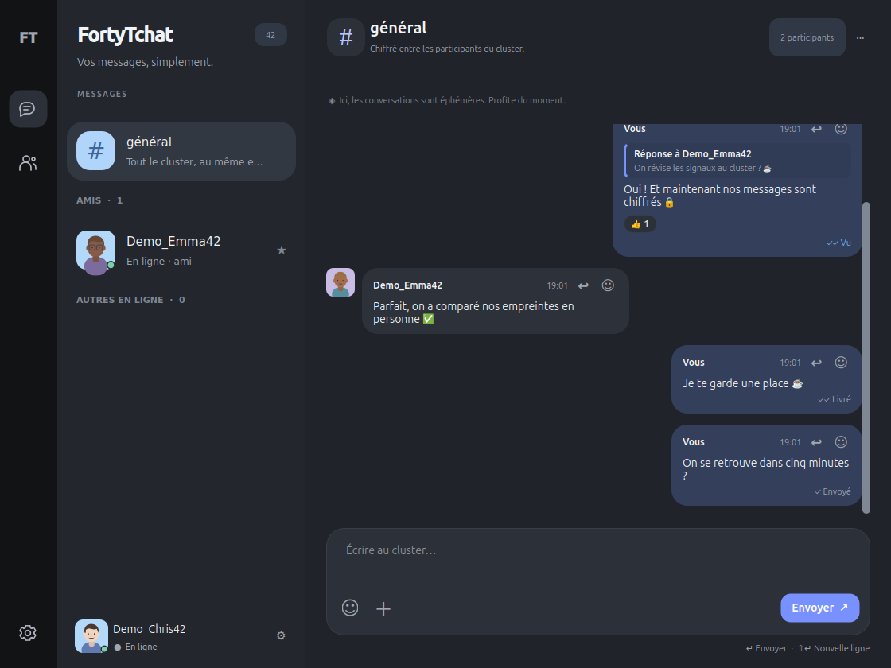</a>
</p>

<p align="center"><em>Le salon général et les amis, réunis dans une interface sombre. Profils de démonstration.</em></p>

<table>
  <tr>
    <td align="center" width="50%" valign="top">
      <h3>Messages privés</h3>
      <a href="docs/social-1.6.0.png">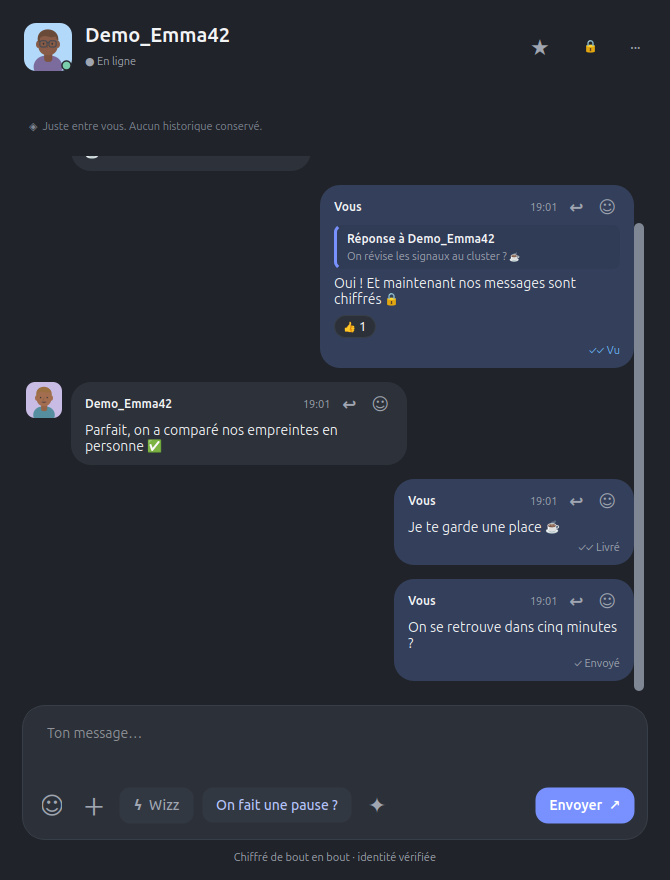</a>
      <p>Réponds, réagis et suis tes messages : envoyé, livré et vu.</p>
    </td>
    <td align="center" width="50%" valign="top">
      <h3>3 781 emojis</h3>
      <a href="docs/emojis-1.1.0.png">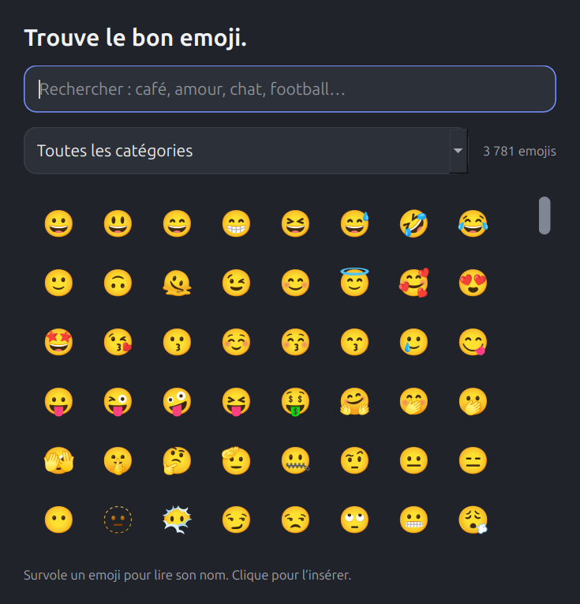</a>
      <p>Neuf catégories et une recherche en français ou en anglais.</p>
    </td>
  </tr>
  <tr>
    <td align="center" width="50%" valign="top">
      <h3>Ton image, ton profil</h3>
      <a href="docs/avatars-photo-import.png">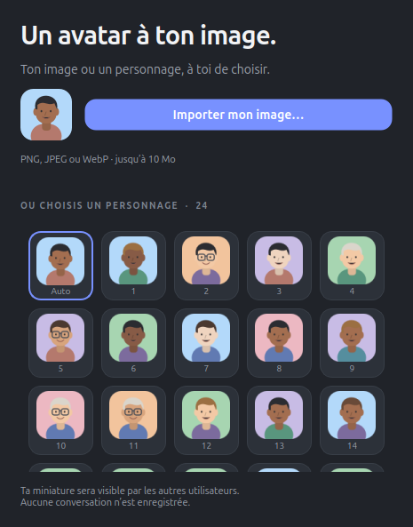</a>
      <p>Choisis un personnage ou importe ta propre photo.</p>
    </td>
    <td align="center" width="50%" valign="top">
      <h3>Le bon cadrage</h3>
      <a href="docs/avatar-crop-preview.png">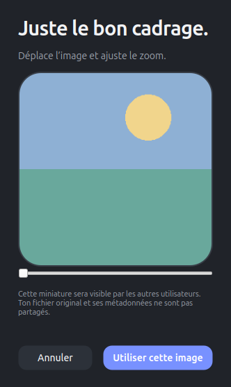</a>
      <p>Déplace, zoome et valide l’aperçu avant de partager ta miniature.</p>
    </td>
  </tr>
  <tr>
    <td align="center" width="50%" valign="top">
      <h3>On fait une pause ?</h3>
      <a href="docs/pause-invite-1.4.0.png">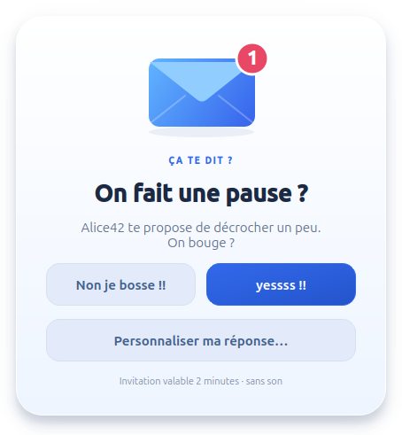</a>
      <p>Une carte au centre de l’écran, même en Ne pas déranger.</p>
    </td>
    <td align="center" width="50%" valign="top">
      <h3>La réponse en un clin d’œil</h3>
      <a href="docs/notification-reply-yes-1.4.0.png">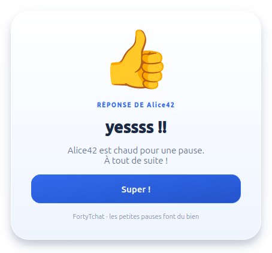</a>
      <p>Bleu pour oui, <a href="docs/notification-reply-no-1.4.0.png">rouge pour non</a>.</p>
    </td>
  </tr>
  <tr>
    <td align="center" width="50%" valign="top">
      <h3>Ta notification, ton style</h3>
      <a href="docs/notification-editor-1.7.0.png">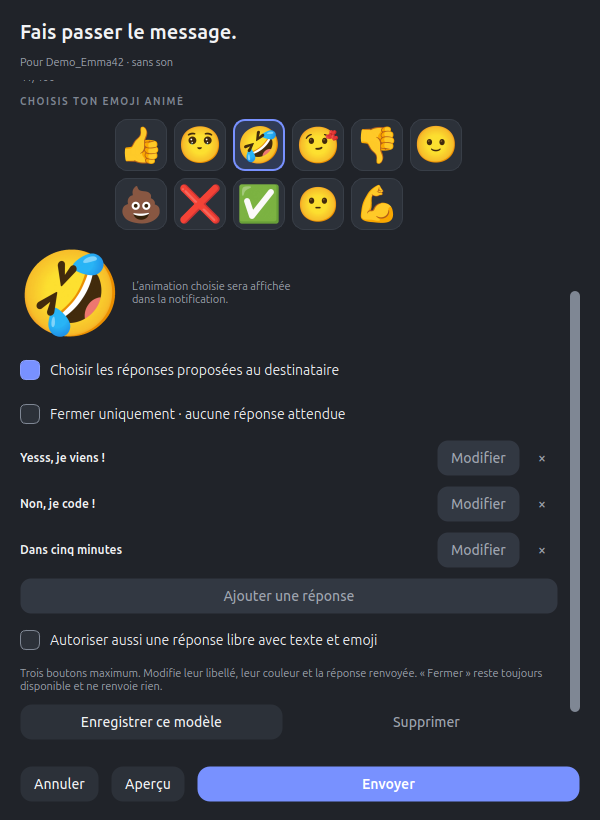</a>
      <p>Choisis ton animation, ton message et les réponses proposées, puis vérifie l’aperçu.</p>
    </td>
    <td align="center" width="50%" valign="top">
      <h3>Tes réponses au choix</h3>
      <a href="docs/notification-choices-1.7.0.png">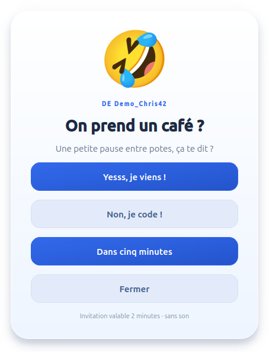</a>
      <p>Oui, Non ou une autre réponse préparée. Fermer ne renvoie rien.</p>
    </td>
  </tr>
</table>

Les aperçus utilisent des profils, des textes et une illustration de démonstration. Clique sur une image pour l’ouvrir en grand.

## Sommaire

- [Aperçu de l’application](#aperçu)
- [Installer et démarrer](#installer-et-démarrer)
- [Mettre à jour](#mettre-à-jour)
- [Désinstaller](#désinstaller)
- [Chiffrement de bout en bout](#chiffrement-de-bout-en-bout)
- [Amis](#amis)
- [Utilisation](#utilisation)
- [Envoyé, livré et vu](#envoyé-livré-et-vu)
- [Répondre et réagir](#répondre-et-réagir)
- [Notifications personnalisées](#notifications-personnalisées)
- [Envoyer un fichier](#envoyer-un-fichier)
- [Avatars et images personnelles](#avatars-et-images-personnelles)
- [Dépannage](#dépannage)
- [Réseau et relais](#réseau-automatique)
- [Tester à domicile](#développer-et-tester-à-domicile)
- [Confidentialité et limites](#confidentialité-et-limites-de-confiance)

## Installer et démarrer

Sur Ubuntu/Linux, avec **Git** et **Python 3.10 ou plus récent**, installation en une ligne dans le dossier caché `~/.FortyTchat` :

```sh
git clone git@github.com:Chrisnox-209/FortyTchat.git "$HOME/.FortyTchat" && sh "$HOME/.FortyTchat/install.sh"
```

Cette commande utilise une clé SSH GitHub déjà configurée. Pour installer le dépôt public sans clé SSH :

```sh
git clone https://github.com/Chrisnox-209/FortyTchat.git "$HOME/.FortyTchat" && sh "$HOME/.FortyTchat/install.sh"
```

Le dépôt reste dans ton dossier personnel sans encombrer les dossiers visibles. `Ctrl+H` affiche les fichiers cachés dans le gestionnaire de fichiers. Si `~/.FortyTchat` existe déjà, utilise la section [Mettre à jour](#mettre-à-jour).

Depuis le dossier du projet, sur Ubuntu avec Python 3.10 ou plus récent :

```sh
sh ./install.sh
```

Le script crée un environnement Python personnel, installe les dépendances, copie l’application, crée son lanceur et l’entrée de démarrage XDG. Il lance ensuite FortyTchat **réduit**, sans ouvrir la fenêtre principale si la barre accepte son icône. Aucune demande de pseudo ou de réseau : un pseudo distinctif est généré et la découverte commence immédiatement.

- Icône noire **FT** dans la barre supérieure lorsque GNOME/StatusNotifier/AppIndicator le permet.
- **L’icône entière devient rouge**, avec le compteur des messages non lus ; elle redevient noire après lecture.
- Doubleclic ou activation principale sur l’icône : ouvrir la fenêtre ; clic milieu également pris en charge. Sur les barres GNOME qui ouvrent seulement un menu au premier clic, la compatibilité décrite ci-dessous reconnaît aussi sa fermeture rapide au second clic. Le menu conserve **Ouvrir FortyTchat**, statut, paramètres et quitter.
- Fermer la fenêtre garde l’application active. **Quitter complètement** ou `Ctrl+Q` efface les conversations de ce processus.
- Sans barre compatible : lancement réduit dans le dock, fenêtre récupérable depuis le dock ou le lanceur. Le titre et la liste indiquent les messages non lus.

**Le placement précis en haut à gauche ou à côté de Discord appartient à GNOME/à ses extensions. L’application ne peut pas l’imposer.** Elle ne modifie ni les extensions ni les préférences du système. Qt documente ces limites d’intégration : [QSystemTrayIcon](https://doc.qt.io/qt-6.12/qsystemtrayicon.html).

**Cas des postes où un clic ouvre le menu mais le doubleclic n’ouvre pas le tchat :** l’option **Paramètres → Général → Compatibilité doubleclic de l’icône (GNOME)** est activée par défaut. Elle reconnaît l’ouverture puis la fermeture du menu dans le délai de doubleclic, sans sélection d’action ni survol d’élément. Elle ignore un clic droit explicitement signalé et n’ouvre pas le tchat à la place d’une action du menu.

Cette reconnaissance dépend des événements transmis par la barre. Une fermeture très rapide, par exemple avec Échap, peut être interprétée comme un second clic si le bureau ne précise pas sa cause ; désactiver l’option dans ce cas. **Le comportement sur les PC de l’école reste à vérifier sur place.** Si la barre ne transmet pas les événements nécessaires, choisir **Ouvrir FortyTchat** dans le menu ou utiliser le lanceur. Aucune extension ni configuration du bureau n’est modifiée. Références : [activation GNOME/AppIndicator](https://github.com/ubuntu/gnome-shell-extension-appindicator), [fermeture des menus dans Qt](https://code.qt.io/cgit/qt/qtbase.git/tree/src/gui/platform/unix/dbusmenu/qdbusmenuadaptor.cpp).

Après une mise à jour, **quitter complètement puis relancer** une instance déjà ouverte charge le nouveau design ; l’installateur le signale sans fermer vos discussions de force.

L’application apparaît dans le menu des applications sous **FortyTchat**. On peut aussi l’ouvrir avec :

```sh
~/.local/bin/fortytchat
```

Si PySide6 et PyNaCl sont déjà disponibles dans votre Python, une installation sans téléchargement est possible :

```sh
sh ./install.sh --use-current-python
```

`--no-launch` installe sans lancer immédiatement ; `--bin-dir DOSSIER` choisit l’emplacement du petit lanceur. Sans `--use-current-python`, le script utilise un venv dédié et ne modifie aucun paquet système.

Si `python3 -m venv` ou les bibliothèques natives nécessaires à Qt sont absents, le script explique l’échec. Il n’installe pas de composants système et ne contourne pas une restriction de l’école. Il faut alors un Python utilisateur déjà équipé ou un environnement fourni par l’établissement. Les wheels Qt restent plus volumineuses qu’une interface Tkinter ; l’interface utilise **PySide6 Essentials** et le chiffrement utilise **PyNaCl/libsodium**. Avec Python 3.14, l’installateur utilise PySide6 6.12 ou plus récent ; `--use-current-python` vérifie aussi cette compatibilité.

## Mettre à jour

Une fois la nouvelle version publiée sur GitHub :

1. Dans le menu de FortyTchat, choisir **Quitter complètement**. Fermer seulement la fenêtre garde le programme actif.
2. Récupérer la dernière version et l’installer :

```sh
git -C "$HOME/.FortyTchat" pull --ff-only && sh "$HOME/.FortyTchat/install.sh"
```

Le dépôt caché est actualisé, puis l’installateur réutilise l’environnement Python et relance FortyTchat réduit. **Le pseudo, les amis, la photo, les modèles, les clés d’identité et de contacts, les préférences et le choix de démarrage automatique sont conservés.** La configuration réseau déjà installée est également reprise, sauf si le dossier source fournit son propre `network.json` de déploiement.

Les messages de la session sont éphémères : quitter l’application les abandonne. Les fichiers déjà enregistrés restent à leur emplacement. Le script signale une instance encore ouverte : la quitter complètement puis relancer le lanceur charge le nouveau code.

Si le dépôt a été cloné dans un autre dossier, se placer dans ce dossier puis exécuter :

```sh
git pull --ff-only && sh ./install.sh
```

Pour réinstaller une copie locale déjà actualisée, exécuter `sh ./install.sh` depuis cette copie après avoir quitté l’application.

La version apparaît dans **Paramètres → À propos** et dans le titre des paramètres. Le lanceur permet aussi de la vérifier :

```sh
~/.local/bin/fortytchat --version
```

## Désinstaller

Pour l’installation dans le dossier caché :

```sh
sh "$HOME/.FortyTchat/uninstall.sh"
```

Depuis une autre copie du projet, utiliser `sh ./uninstall.sh` dans son dossier.

Le script arrête uniquement les processus appartenant à cet utilisateur et exécutant le `main.py` de la copie installée. Il supprime l’application, son environnement Python dédié, son lanceur, son entrée de menu et son autostart, sans sudo et sans toucher aux autres applications. Le profil, les amis, la photo, les modèles et les clés de chiffrement restent dans l’espace de configuration personnel.

Pour supprimer aussi ces données :

```sh
sh "$HOME/.FortyTchat/uninstall.sh" --purge
```

`--purge` efface également les profils de développement. Cette suppression inclut les clés et leurs vérifications. Une réinstallation créera alors une nouvelle identité de profil et les anciens contacts ne pourront plus la reconnaître automatiquement. Si un autre dossier de lanceur a été choisi à l’installation, préciser le même avec `--bin-dir DOSSIER`.

## Lancer depuis les sources

Si les dépendances sont disponibles :

```sh
python3 main.py
```

Sinon, créer un environnement utilisateur, puis lancer :

```sh
python3 -m venv .venv
. .venv/bin/activate
python3 -m pip install -r requirements.txt
python3 main.py
```

Le premier lancement démarre réduit ; les lancements suivants ouvrent la fenêtre ou réactivent l’instance existante. `python3 main.py --background` démarre discrètement. Une seule instance fonctionne par utilisateur et session graphique ; aucun verrou partagé entre machines n’est utilisé.

## Démarrage automatique et fichiers personnels

Valeurs par défaut, avec respect de `XDG_CONFIG_HOME` et `XDG_DATA_HOME` lorsqu’ils sont absolus :

| Fichier/dossier | Usage |
| --- | --- |
| `~/.FortyTchat/` | Dépôt source caché utilisé pour les mises à jour |
| `~/.local/share/fortytchat/app/` | Application installée, indépendante du dossier téléchargé |
| `~/.local/share/fortytchat/venv/` | Interpréteur et dépendances dédiés |
| `~/.local/share/applications/fr.fortytchat.FortyTchat.desktop` | Entrée du menu |
| `~/.local/bin/fortytchat` | Lanceur |
| `~/.config/fortytchat/notification_templates.json` | Modèles de notification et de réponse enregistrés volontairement |
| `~/.config/fortytchat/identity.json` | Clé privée d’identité du profil (permissions 600), jamais envoyée sur le réseau |
| `~/.config/fortytchat/trusted_contacts.json` | Clés publiques mémorisées et état des vérifications (permissions 600), aucun message |
| `~/.config/fortytchat/config.json` | Pseudo, identifiant de profil, amis, miniature personnelle, thème, préférence de partage de lecture et date du dernier Wizz |
| `~/.local/share/fortytchat/app/network.json` | Paramètres réseau de déploiement, sans accès depuis l’interface |
| `~/.config/autostart/fr.fortytchat.FortyTchat.desktop` | Démarrage personnel, avec chemins absolus et `--background` |
| `/tmp/fortytchat-UID/` | Verrou et socket d’activation privés, aucun message de chat |

La case **Lancer FortyTchat au démarrage** applique immédiatement le choix. Le programme lit aussi l’état réel du fichier `.desktop`. Un choix désactivé, une entrée supprimée ou une entrée externe désactivée ne sont pas réactivés à un lancement ou à une réinstallation. Seule l’entrée appartenant à FortyTchat est gérée.

La création de l’entrée ne garantit pas que la politique de la session exécutera XDG Autostart. L’installer dans un venv sans le déplacer ensuite évite les chemins d’interpréteur cassés. Après déplacement du dossier source, relancer l’application actualise les chemins d’une entrée toujours activée.

Référence : [spécification XDG Autostart](https://specifications.freedesktop.org/autostart/latest/).

## Utilisation

- Cliquer sur son avatar, ou ouvrir **Paramètres → Changer d’avatar**, permet de choisir parmi **24 personnages illustrés**, un mode automatique ou **Importer mon image…**. Sélectionne un PNG, JPEG ou WebP de moins de 10 Mo, déplace le cadrage, ajuste le zoom puis valide. La miniature est conservée comme préférence de profil et devient visible chez les autres utilisateurs. Choisir un personnage retire l’image personnelle.
- **#général** accueille automatiquement chaque nouvelle session ; aucun message antérieur n’est envoyé.
- Cliquer directement sur une personne dans **En ligne** ouvre une conversation privée dans une **nouvelle fenêtre indépendante**. Aucun champ de recherche à remplir. Plusieurs fenêtres privées peuvent rester ouvertes. Les IDs de session, distincts des pseudos et des IP, identifient les destinataires. Les collisions de pseudo sont résolues avec un suffixe et le nouveau nom est annoncé immédiatement.
- `Entrée` envoie, `Maj+Entrée` ajoute une ligne ; `Ctrl+K` place le focus sur les utilisateurs en ligne ; `Ctrl+,` ouvre les paramètres.
- Le sélecteur propose **3 781 emojis**, neuf catégories et une recherche français/anglais (par exemple « café », « coeur », « chat » ou « football »). Le catalogue est embarqué et fonctionne hors ligne ; la grille affiche les éléments visibles sans créer des milliers de boutons. Les glyphes absents de la police ont un libellé de remplacement dans le sélecteur ; leur insertion reste Unicode.
- **Wizz** : un seul envoi toutes les **42 minutes**, tous destinataires confondus. Le bouton indique le délai. La conversation s’ouvre au dernier message et vibre dans toutes les directions pendant **2,8 secondes**. Sous X11, la fenêtre bouge ; sous Wayland, son contenu vibre, car le bureau contrôle le placement et la mise au premier plan. Aucun son n’est joué.
- **On fait une pause ?** ouvre une carte bleue au centre de l’écran, valable 2 minutes. « yessss !! » et « Non je bosse !! » renvoient une réponse affichée au centre de l’écran de l’expéditeur : bleu pour oui, rouge pour non. Fermer la carte signale une invitation non confirmée. **Trois demandes successives** sont autorisées par destinataire ; la quatrième bloque les demandes de pause de cet expéditeur pendant **5 minutes**. Après 5 minutes sans demande, une nouvelle série commence. Les messages restent disponibles et le blocage des pauses ne se prolonge pas à chaque tentative.
- Le menu `···` d’une conversation permet de masquer/démasquer une session. Le masquage expire à l’arrêt de l’application, car les identifiants sont temporaires.
- Le mode **Ne pas déranger** laisse arriver les messages et fichiers sans notification et refuse les Wizz et les nouvelles notifications personnalisées. **Les invitations de pause et les réponses aux demandes déjà reçues restent actives**, y compris les cartes à l’écran.
- Notifications via `notify-send` lorsqu’il est disponible, avec `suppress-sound=true` et **sans texte de conversation**. Sinon l’application conserve les badges et les indications internes.

Dans **Paramètres → À propos**, retrouve la version installée, le lien GitHub, les fonctions et les données conservées.

<details>
<summary>Voir l’onglet À propos</summary>

<p align="center">
  <a href="docs/about-1.8.0.png">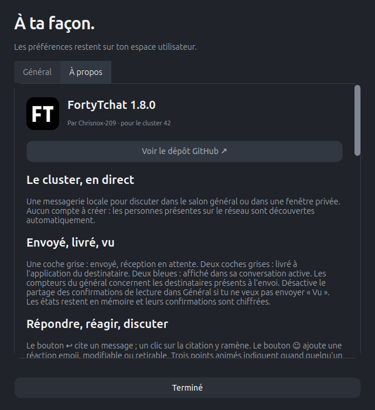</a>
</p>

Le contenu est défilable pour rester lisible sur les petits écrans.

</details>

Les messages sont affichés en texte brut, jamais comme du HTML exécutable. La fenêtre affiche les messages acceptés localement puis signale une livraison non confirmée. Un message envoyé sans autre utilisateur n’est visible que localement et n’est pas remis aux personnes arrivant ensuite.

## Envoyé, livré et vu

Les messages envoyés affichent leur état dans leur bulle :

| Indication | Signification |
| --- | --- |
| **✓ Envoyé**, gris | Envoi lancé, confirmation du destinataire en attente |
| **✓✓ Livré**, gris | L’application du destinataire a accepté le message et renvoyé une confirmation authentifiée |
| **✓✓ Vu**, bleu | Le destinataire a affiché le message dans la zone visible de sa conversation active |
| **! Non confirmé** | La confirmation n’est pas arrivée ; le message a pu être reçu. Aucun renvoi automatique après reconnexion |
| **○ Local** | Aucun autre participant : message visible uniquement ici |

Une fenêtre fermée, masquée, minimisée ou derrière une autre fenêtre active n’envoie pas « Vu ». Si la personne remonte la conversation, un nouveau message hors de la zone visible n’est pas marqué vu. Ce statut indique un affichage rapporté par son application, sans garantir une lecture attentive.

Dans le **général**, les compteurs se rapportent aux destinataires en ligne choisis lors de l’envoi. Les deux coches deviennent bleues quand **tous** ont confirmé la lecture. Le survol détaille les confirmations de livraison et de lecture, avec les noms ; une confirmation partielle n’est pas présentée comme une lecture par tout le groupe. Les personnes arrivées plus tard ne sont pas ajoutées à ces compteurs.

[**Paramètres → Général → Partager les confirmations de lecture**](docs/settings-1.6.0.png) est activé par défaut. Le désactiver empêche l’envoi de nouveaux « Vu », tout en laissant les livraisons confirmées et les confirmations reçues affichées. Cela ne retire pas les « Vu » déjà partagés. Le réactiver permet de confirmer les messages alors visibles dans une conversation active.

Toutes ces confirmations passent dans les enveloppes **chiffrées de bout en bout**. Les états restent en RAM avec la conversation ; aucun historique de lecture, texte ou horaire de lecture n’est enregistré sur disque. Les deux clients doivent annoncer la fonction **1.6.0**. Un ancien client chiffré **1.5.0** continue à échanger les messages et ACK de livraison ; aucun événement de lecture inconnu ne lui est envoyé. Le relais opaque **1.5.0 minimum** convient également. Les confirmations restent disponibles pendant la session, sans boîte d’envoi ou rattrapage durable après arrêt.

## Répondre et réagir

- **Répondre** : cliquer sur **↩** dans une bulle. Le message choisi apparaît au-dessus du champ de saisie ; écrire la réponse puis envoyer. Le bouton **×** annule la citation. Cliquer sur une citation dans la conversation ramène au message d’origine et le met en évidence.
- **Réagir** : cliquer sur **☺** dans une bulle, choisir une des six réactions rapides ou **Tous les emojis…** pour ouvrir le catalogue complet. Une personne peut avoir une réaction par message. Choisir un autre emoji remplace la sienne ; cliquer de nouveau sur le même la retire. Les pastilles affichent le compteur et les noms au survol ; ta réaction est mise en évidence.
- **Voir la saisie en direct** : trois points animés et le nom de la personne apparaissent sous les messages pendant qu’elle écrit, en privé ou dans le général. L’indicateur disparaît après l’envoi, le changement de fenêtre ou l’inactivité. Le brouillon reste sur le poste de son auteur.

Ces interactions restent en mémoire avec les messages et disparaissent à l’arrêt complet. Une citation dont le message d’origine est inconnu ou a quitté la mémoire du destinataire affiche **Message plus disponible** ; aucun ancien message n’est téléchargé pour la reconstituer.

Les réactions et la saisie passent dans les enveloppes chiffrées, comme les messages. Les participants et le relais doivent utiliser **FortyTchat 1.5.0 ou plus récent** ; il n’existe aucun repli en clair.

## Notifications personnalisées

Dans une conversation privée, cliquer sur **✦** pour créer une notification :

1. Choisir un **titre** (80 caractères maximum), un **texte** (400 caractères) et l’un des **11 emojis animés**.
2. Dans **Choisir les réponses proposées au destinataire**, préparer jusqu’à **trois boutons**. **Modifier** permet de choisir leur libellé (32 caractères), leur type **Oui**, **Non** ou **Autre**, et le titre, texte et emoji qui seront renvoyés à l’expéditeur.
3. Cocher **Autoriser aussi une réponse libre** pour laisser le destinataire écrire autre chose. Décocher pour limiter les réponses aux boutons préparés.
4. Pour une simple information, cocher **Fermer uniquement · aucune réponse attendue** : aucun bouton Oui/Non et aucune réponse n’est envoyée à la fermeture.
5. Utiliser **Aperçu**, puis **Envoyer**. La carte apparaît au centre de l’écran, sans son.

**Fermer reste toujours disponible** sur les cartes avec ces nouveaux choix : bouton, croix/fermeture, Échap et expiration ne renvoient ni acceptation ni refus. Cliquer sur un bouton préparé renvoie exactement la réponse définie par l’auteur. Le retour s’affiche en **bleu pour Oui ou Autre**, en **rouge pour Non**. Une réponse libre peut inclure un texte et une animation choisis par le destinataire.

<table>
<tr>
<td align="center" width="50%"><a href="docs/notification-choices-1.7.0.png"></a><p>Les réponses sont choisies par l’expéditeur.</p></td>
<td align="center" width="50%"><a href="docs/notification-info-1.7.0.png">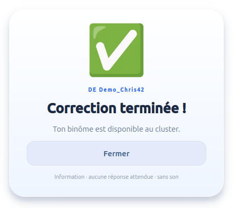</a><p>Une information à fermer, sans réponse renvoyée.</p></td>
</tr>
</table>

Le [**détail d’une réponse proposée**](docs/notification-response-editor-1.7.0.png) permet de préparer son libellé, son type, son texte et son emoji. Les demandes de pause classiques gardent leurs réponses habituelles et restent actives en Ne pas déranger.

<p align="center">
  
  
  
</p>

Animations disponibles : **👍 😭 🤣 😘 👎 😛 💩 ❌ ✅ 🤯 💪**. Elles sont intégrées à l’installation ; les destinataires ne téléchargent rien et aucune URL d’image n’est envoyée sur le réseau.

**Enregistrer ce modèle** conserve volontairement le titre, le texte, l’animation et les choix de réponse dans ton profil. Jusqu’à **12 modèles**, notifications et réponses confondues, peuvent être créés, modifiés ou supprimés. [**Paramètres → Mes notifications animées**](docs/settings-1.4.0.png) permet de les préparer même sans personne en ligne. Les notifications reçues et les réponses envoyées restent uniquement dans la conversation en mémoire, sauf les modèles que tu choisis explicitement d’enregistrer.

Une demande reste valable **2 minutes**. Pauses et notifications personnalisées partagent la limite de **3 demandes successives par destinataire** ; la quatrième bloque leurs nouveaux envois pendant **5 minutes**, en laissant les messages disponibles. **Ne pas déranger** refuse les nouvelles notifications personnalisées ; les pauses classiques et les réponses aux demandes déjà reçues restent actives.

Les choix de réponse nécessitent **FortyTchat 1.7.0 chez les deux participants**. Un relais chiffré 1.5.0 minimum convient, car il transporte des enveloppes opaques. Les anciens clients chiffrés continuent à échanger les cartes classiques ; l’éditeur leur signale qu’un modèle avec choix exige une mise à jour, sans transformer silencieusement une carte Fermer uniquement en question Oui/Non. Les anciennes cartes sans choix explicites gardent leur fonctionnement antérieur. Toutes les cartes et réponses sont chiffrées de bout en bout.

## Envoyer un fichier

Le bouton **＋** joint un fichier dans le salon général ou une conversation privée. Le destinataire clique sur **Enregistrer…**, choisit un emplacement, ou refuse. La progression et l’annulation apparaissent dans le chat. Limite : **20 Mio par fichier**, offre valable **10 minutes**, clients et relais **1.5.0 ou plus récent** requis. Le nom, l’empreinte et les blocs du fichier sont chiffrés de bout en bout. Aucun téléchargement automatique, aucune ouverture automatique ; un fichier existant n’est jamais écrasé. Les fichiers acceptés et enregistrés restent sur le disque après fermeture de l’application.

## Chiffrement de bout en bout

Le chiffrement est **toujours actif** : messages privés et généraux, citations, réactions, indicateurs de saisie, Wizz, pauses, notifications et pièces jointes sont chiffrés sur l’appareil de l’expéditeur et déchiffrés sur celui du destinataire. Le relais transporte des enveloppes opaques et ne possède aucune clé de déchiffrement. Le général envoie une copie chiffrée distincte à chaque participant autorisé en ligne ; ce salon reste ouvert aux personnes présentes dans le cluster.

<p align="center">
  <a href="docs/security-1.5.0.png">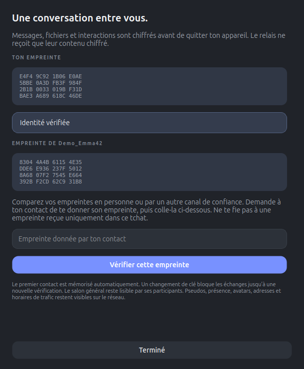</a>
</p>

Pour vérifier un contact :

1. Ouvrir sa conversation et cliquer sur le **cadenas 🔒**.
2. Comparer vos empreintes **en personne ou par un autre canal de confiance**. Ton empreinte est aussi disponible dans **Paramètres → Mon identité de chiffrement**.
3. Coller l’empreinte donnée par le contact et cliquer sur **Vérifier cette empreinte**. Le statut passe à **Identité vérifiée** après correspondance complète.

La première clé reçue est mémorisée automatiquement (*TOFU*). Une modification ultérieure affiche **Clé modifiée** et bloque les échanges, y compris les fichiers et les envois du général vers ce contact. Si le changement est légitime, comparer sa nouvelle empreinte avant de l’autoriser. Ne pas valider une empreinte reçue seulement dans la conversation dont l’identité est en question.

L’application utilise les primitives de **PyNaCl/libsodium** : `Box` (Curve25519, XSalsa20-Poly1305), nonces aléatoires, signatures **Ed25519** liant l’identité aux clés de session et aux annonces de présence. Les enveloppes authentifient aussi l’expéditeur, le destinataire, leur identifiant et leur compteur ; les modifications et les rejeux sont refusés. Les confirmations de réception sont chiffrées et liées au bon destinataire. Références : [chiffrement Box](https://pynacl.readthedocs.io/en/latest/public/), [signatures Ed25519](https://pynacl.readthedocs.io/en/latest/signing/).

La clé d’identité reste dans `identity.json` et le carnet de clés publiques dans `trusted_contacts.json`, avec permissions **600**. Les clés de chiffrement de session sont créées en mémoire à chaque démarrage et ne sont pas archivées. Une mise à jour conserve ces fichiers. Sauvegarder le profil exige de protéger aussi ces clés privées ; conserver `config.json`, `identity.json` et `trusted_contacts.json` ensemble. Un fichier de sécurité corrompu, manquant dans un profil déjà initialisé ou non privé arrête le démarrage au lieu de réinitialiser silencieusement les clés.

**Tous les clients et le relais doivent être actualisés en 1.5.0 ou plus récent.** Les trames de conversation en clair et les relais sans prise en charge E2EE sont refusés. Le chiffrement n’empêche pas de capturer le trafic chiffré, ne cache pas les métadonnées et ne protège pas un appareil compromis ni les copies faites par un destinataire. Cette intégration n’a pas fait l’objet d’un audit indépendant ; elle n’implémente pas le Double Ratchet ni le renouvellement des clés après chaque message. Une compromission des clés de session en mémoire expose les échanges de cette session.

## Amis

Dans une conversation privée, cliquer sur **☆** pour ajouter la personne aux amis. Un clic droit sur une personne dans la liste propose aussi **Ajouter aux amis**. La section **AMIS** apparaît au-dessus des autres utilisateurs et conserve les contacts hors ligne.

### Depuis l’icône FT

**Clic droit sur l’icône → Amis en ligne → nom de l’ami → Envoyer une popup…** ouvre directement l’éditeur : titre, texte, emoji animé et réponses proposées. La fenêtre de tchat peut rester fermée. Le clic droit sur un ami dans la liste du tchat propose aussi **Envoyer une popup…**.

Les sous-menus **Amis en ligne** et **Amis hors ligne** affichent leurs effectifs. Chaque ami propose **Discuter…** et **Envoyer une popup…**. L’envoi de popup est désactivé hors ligne, pour une session masquée, une clé modifiée ou une connexion incompatible. Aucun envoi hors ligne n’est mis en attente. L’action retrouve la session actuelle de l’ami, même après une reconnexion ou un changement de pseudo.

<p align="center">
  <a href="docs/tray-friends-1.8.0.png">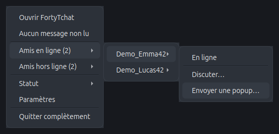</a>
</p>

<p align="center"><em>Menus Qt réels avec des amis de démonstration ; l’apparence du menu exporté dans la barre dépend de la session Ubuntu.</em></p>

### Quand un ami se connecte

Une bannière native **« Pseudo est en ligne »** apparaît via le service de notifications Ubuntu, avec l’icône FortyTchat et sans son demandé. Plusieurs arrivées dans la même mise à jour sont regroupées. [**Paramètres → Général → Notifier la connexion de mes amis**](docs/settings-1.8.0.png) permet de désactiver ces alertes ; **Ne pas déranger** les masque aussi, sans les réafficher ensuite.

Les cinq premières secondes du démarrage restent silencieuses pour éviter une rafale liée à la découverte initiale. Changer de pseudo ou de statut, utiliser une deuxième session et ajouter un ami déjà connecté ne produit pas d’alerte. Les reconnexions après moins de cinq secondes d’absence sont ignorées et un même ami ne déclenche pas plus d’une alerte par minute. Une clé modifiée ou une session masquée ne déclenche pas d’alerte.

Ces bannières utilisent `notify-send` lorsqu’il est disponible. Leur apparence, leur emplacement — généralement en haut au centre sous Ubuntu/GNOME — et leur affichage dépendent du bureau et de son propre mode Ne pas déranger ; voir [l’aide GNOME sur les notifications](https://help.gnome.org/gnome-help/shell-notifications.html.en). Le fonctionnement suit le [service de notifications freedesktop](https://specifications.freedesktop.org/notification/latest-single/). Il ne faut pas les confondre avec les cartes animées envoyées volontairement à un ami.

### Reconnaissance des amis

Chaque profil possède un identifiant persistant, distinct du pseudo, de l’adresse IP et de l’identifiant temporaire de session. Une personne qui change son pseudo ou relance l’application est reconnue dès qu’elle se reconnecte avec le même profil. Le nouveau pseudo remplace automatiquement le précédent dans la liste. La conversation encore ouverte se rattache à sa nouvelle session, sans récupérer d’historique sur le réseau.

La liste est personnelle et enregistrée uniquement dans les préférences ; **aucun message n’est conservé sur disque**. Choisir **Retirer des amis** dans le menu ou cliquer de nouveau sur l’étoile retire le contact. Jusqu’à 256 amis peuvent être conservés. Garder le dossier de configuration conserve cette identité lors d’une réinstallation ou avec un espace personnel partagé entre postes.

L’identifiant de profil est maintenant lié à une clé d’identité mémorisée. Le **cadenas** permet de vérifier son empreinte ; le pseudo seul ne prouve pas qui est la personne. Un contact dont la clé a changé affiche **Clé modifiée · vérifier** dans les amis : cliquer dessus ouvre la comparaison des empreintes. Sa session ne récupère pas automatiquement la conversation d’un ami tant que sa nouvelle empreinte n’est pas vérifiée.

## Avatars et images personnelles

Cliquer sur son avatar en bas à gauche, puis sur **Importer mon image…**. Choisir un PNG, JPEG ou WebP de moins de 10 Mo, déplacer l’image pour cadrer le sujet, ajuster le zoom et cliquer sur **Utiliser cette image**. L’import se fait sans bloquer l’interface ; annuler n’applique aucun changement.

Les images personnelles sont réduites en JPEG 128 × 128, au plus 8 Kio. Le fichier original, son nom et ses métadonnées ne sont pas transmis. Seule ta propre miniature est conservée dans les préférences ; celles reçues des autres restent en mémoire. Elles passent par TCP ou par le relais mis à jour, jamais dans les annonces UDP. Les avatars servent de profil public : leur miniature reste visible sur le réseau, à la différence du contenu des conversations.

Pour enlever sa photo, choisir **Retirer mon image** ou sélectionner un personnage. Les 24 personnages et le mode automatique restent disponibles.

## Dépannage

| Problème | Vérification ou solution |
| --- | --- |
| Texte tronqué dans les paramètres | Suivre [Mettre à jour](#mettre-à-jour), puis vérifier la version réellement ouverte. Vérifier que le titre de la fenêtre des paramètres indique 1.8.0 ; l’ancienne instance doit être fermée. Les onglets Général et À propos sont défilables ; utiliser la molette ou la barre à droite. La correction est vérifiée à 100 %, 150 % et 200 % de mise à l’échelle. |
| Ancienne icône violette « 42 » | L’ancienne application tourne peut-être encore. La quitter depuis son menu, puis relancer `sh ./install.sh` depuis le projet actualisé. La nouvelle icône est noire avec **FT** en blanc. |
| Contact absent après mise à jour | Actualiser les deux clients et le relais en 1.5.0 minimum ; les clients sans identité signée sont refusés. |
| Clé du contact modifiée | Échanges bloqués : ouvrir son cadenas, comparer la nouvelle empreinte par un canal de confiance puis la vérifier. |
| Identité de chiffrement inaccessible | Restaurer les fichiers du profil et leurs permissions 600 ; ne pas supprimer les clés pour contourner l’erreur. |
| Aucune personne en ligne à la maison | C’est normal si aucun autre client ne tourne sur le réseau. Pour tester sur un seul PC, ouvrir les deux profils de développement décrits plus bas. |
| Personnes non détectées sur deux PC | Vérifier que les deux machines sont autorisées à communiquer. Le diagnostic est réservé aux commandes de la section réseau ; aucun réglage réseau n’est accessible dans l’interface. Le Wi-Fi invité, les VLAN ou des politiques d’isolation peuvent empêcher les échanges. |
| Port déjà occupé | Vérifier qu’une autre instance ou un autre service écoute avec `ss -tuln`. Pour plusieurs clients sur le même PC, utiliser `--dev alice` et `--dev bob`, sans changer de ports système. |
| Icône de barre absente | Le support GNOME/AppIndicator dépend de la session. FortyTchat reste accessible dans le dock ou le menu des applications. |
| Aucune alerte de connexion d’un ami | Vérifier l’option dans Général, le mode Ne pas déranger de FortyTchat et celui d’Ubuntu, ainsi que la disponibilité de `notify-send`. La découverte initiale, les petites coupures et les reconnexions trop rapprochées restent silencieuses. |
| Envoyer une popup grisé dans les amis | L’ami doit être connecté avec une clé autorisée, non masqué et compatible avec les notifications animées. Le relais doit les prendre en charge si aucune route directe n’est disponible. |
| Application absente au début de session | Vérifier **Lancer FortyTchat au démarrage** et la politique XDG Autostart de la session. Le programme ne contourne pas une politique qui le désactive. |

<details>
<summary><strong>Captures Ubuntu fournies pendant les essais — ancien affichage</strong></summary>

Ces deux captures ont été fournies pendant les essais sur un PC Ubuntu. Elles montrent le problème de texte tronqué signalé sur une ancienne instance de l’application. La procédure de réinstallation ci-dessus permet de charger les fichiers corrigés ; la version de la fenêtre est indiquée dans son titre.

<p align="center">
  <a href="docs/screenshots/ubuntu-parametres-ancien-affichage.png">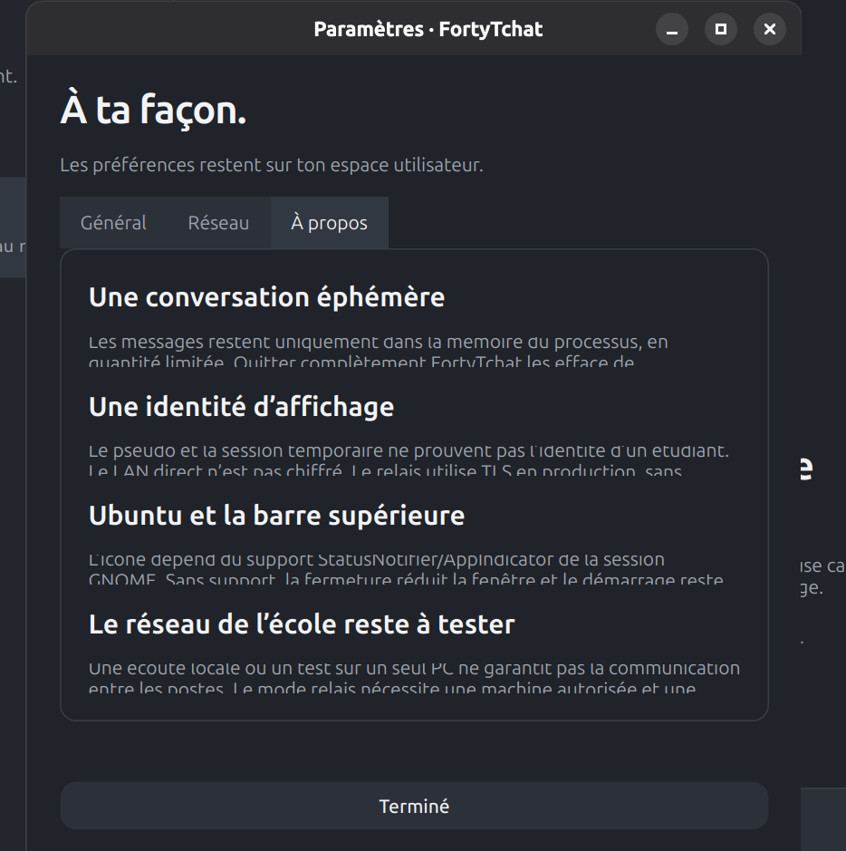</a>
</p>

<p align="center"><em>Onglet À propos : signalement initial sur Ubuntu.</em></p>

<p align="center">
  <a href="docs/screenshots/ubuntu-champs-ancien-affichage.png">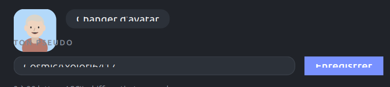</a>
</p>

<p align="center"><em>Champs de profil : détails du problème d’affichage signalé.</em></p>

</details>

## Réseau automatique

| Service | Protocole | Port par défaut |
| --- | --- | --- |
| Découverte | UDP | **39741** |
| Messages et fichiers directs | TCP | **39742** |
| Relais facultatif | TCP + TLS | **39743** |

Les interfaces IPv4 actives sont énumérées à chaque lancement, puis revérifiées périodiquement. Les interfaces physiques sont prioritaires ; loopback, Docker, ponts et interfaces virtuelles connues sont exclues. Une interface active non physique restante peut servir de secours, avec une indication dans le diagnostic. L’adresse observée `10.12.10.7` n’est jamais utilisée comme adresse fixe dans l’application.

La découverte calcule le broadcast depuis le masque réel de l’interface sélectionnée. Elle utilise ce broadcast, le broadcast limité et le groupe multicast local `239.42.42.42` (TTL 1). Les annonces, inférieures à 1 Kio, partent toutes les **23 à 27 secondes** avec une réponse d’accueil temporisée et limitée. Les présences expirent après environ 90 secondes, au prochain passage de nettoyage ; une fermeture propre annonce le départ.

Les messages du salon sont transmis par **TCP avec ACK**, identifiant unique, déduplication et une nouvelle tentative bornée si l’ACK direct est perdu. Aucun texte de chat ne passe dans les annonces UDP. En P2P, la diffusion du général fait un envoi à chaque pair, avec 24 connexions sortantes simultanées au maximum. Pour environ 200 utilisateurs actifs, un relais autorisé est préférable.

Aucun scan, aucune recherche sur toutes les IP du `/16`, aucune modification de pare-feu. Un port déjà occupé est signalé, sans substitution silencieuse du port TCP de production. L’ouverture est retentée périodiquement. Pour plusieurs processus sur un seul PC, utiliser les profils de développement ci-dessous.

## Mode relais

Aucun serveur n’est fourni ou supposé disponible à l’école. Une personne autorisée doit déployer un relais et distribuer son nom DNS dans `network.json` avec le projet. Les étudiants continuent à lancer la même commande, sans saisir d’adresse.

Copier `network.example.json` vers `network.json`, puis renseigner le déploiement autorisé, par exemple :

```json
{
  "mode": "auto",
  "udp_port": 39741,
  "tcp_port": 39742,
  "relay_host": "chat.exemple.org",
  "relay_port": 39743
}
```

`chat.exemple.org` est un exemple à remplacer par le DNS réellement déployé. `relay_ca` peut désigner un fichier d’autorité de certification approuvé ; sinon les autorités système sont utilisées. Un certificat invalide n’entraîne jamais un basculement silencieux en clair.

- `auto` : préfère le relais configuré quand il répond ; découverte LAN en secours. Les destinataires connus des deux chemins ne reçoivent qu’une copie.
- `lan` : découverte et messages directs uniquement.
- `relay` : pas de découverte UDP ; présence et messages via le relais configuré.

Serveur de production, sur une machine autorisée, avec un certificat correspondant au DNS :

```sh
python3 -m src.networking.relay --host 0.0.0.0 --port 39743 --cert /chemin/cert.pem --key /chemin/key.pem
```

Le relais utilise uniquement la RAM, borne ses files, lie l’expéditeur à sa connexion et applique les limites d’envoi. Un redémarrage repart sans messages ni présences. Une reconnexion n’entraîne aucun rejeu d’historique. La reconnexion client emploie un délai progressif de 2 à 60 secondes.

Détails du protocole, de la livraison et des limites : [docs/NETWORK.md](docs/NETWORK.md).

## Diagnostic en ligne de commande

Les boutons, l’onglet et le menu Réseau ont été retirés de l’interface. Les paramètres de déploiement sont uniquement dans `network.json`, à côté de `main.py`. L’installateur crée ce fichier à partir de `network.example.json` lors de la première installation et conserve un fichier déjà configuré. Dans l’installation standard : `~/.local/share/fortytchat/app/network.json`.

Les commandes de diagnostic restent disponibles pour la maintenance, sans contenu de conversation.

Commandes sans sudo :

```sh
hostname -I
ip -br addr
ip -4 route
ss -tuln
python3 main.py --diagnose
python3 tools/network_probe.py
```

Les deux dernières commandes font uniquement des essais de bind locaux. Si FortyTchat tourne déjà, son propre port peut être signalé occupé : ce résultat est attendu pendant son fonctionnement.

Procédure détaillée sur deux PC de l’école, à compléter sur place : [docs/SCHOOL_CHECKLIST.md](docs/SCHOOL_CHECKLIST.md).

## Développer et tester à domicile

Plusieurs fenêtres, configurations isolées, même découverte UDP et ports TCP dynamiques ; ces commandes **ne modifient pas l’autostart** :

```sh
python3 main.py --dev alice
python3 main.py --dev bob
```

Les préférences de développement sont sous `~/.config/fortytchat-dev/PROFIL/`. Chaque nouveau processus a une nouvelle session et aucun message précédent.

Relais local sans TLS, strictement limité à la boucle locale et explicitement réservé au développement :

```sh
python3 -m src.networking.relay --insecure-local --port 39743
python3 main.py --dev alice --insecure-local-relay 39743
python3 main.py --dev bob --insecure-local-relay 39743
```

Tests automatisés :

```sh
python3 -m pip install -r requirements-dev.txt
QT_QPA_PLATFORM=offscreen python3 -m pytest -q
python3 tools/stress_test.py --clients 200
```

La suite locale comprend **168 tests** pour la version 1.8.0. Exécuter les tests dans l’environnement Python équipé des dépendances du projet. Les tests créent seulement des dossiers temporaires pour la configuration, l’installation et les pièces jointes. Ils couvrent notamment TCP réel, UDP multicast réel, ACK perdu, déduplication, 40 clients de relais, messages privés, reconnexion après redémarrage, anti-spam, Wizz global, réponses citées, réactions ajoutées/remplacées/retirées, saisie transitoire, refus des clients et relais non chiffrés, notifications animées, modèles enregistrables, réponses personnalisées, DND avec pauses actives, blocage des pauses après trois demandes, transfert et intégrité des fichiers, annulation, instance unique, XDG, configuration endommagée, badge, interface, absence de persistance des messages, clés privées à permissions restreintes, signatures, anti-rejeu, changements de clé bloqués, confidentialité du contenu vis-à-vis du relais, livraisons authentifiées, confirmations de lecture, visibilité réelle et préférence de lecture. Les nouveaux essais couvrent aussi les menus d’amis, l’éditeur ciblé après reconnexion, les alertes regroupées et silencieuses et leur désactivation. Un environnement qui interdit les sockets ne peut pas exécuter ces tests d’intégration sans autorisation adaptée.

Les résultats locaux et leurs limites sont consignés dans [docs/VALIDATION.md](docs/VALIDATION.md).

## Crédits des animations

Les 11 GIF **Animated Noto Emoji de Google**, fournis via les liens EmojiTerra, sont distribués sous [CC BY 4.0](https://creativecommons.org/licenses/by/4.0/), conformément à la [documentation officielle Noto](https://googlefonts.github.io/noto-emoji-files/?view=docs). Les fichiers sont intégrés sans modification ; seul leur affichage est redimensionné. Sources, empreintes et attribution : [assets/animated/ATTRIBUTION.md](assets/animated/ATTRIBUTION.md). La licence complète accompagne les fichiers : [assets/animated/LICENSE.txt](assets/animated/LICENSE.txt).

## Données Unicode

Le catalogue d’emojis utilise [Unicode Emoji 16.0](https://www.unicode.org/Public/emoji/16.0/emoji-test.txt) et les annotations françaises [CLDR 46.1](https://github.com/unicode-org/cldr-json/tree/46.1.0). La licence est fournie dans `assets/emoji/UNICODE_LICENSE.txt`. `tools/build_emoji_catalog.py` permet de reconstruire les données ; l’application utilise directement le catalogue embarqué.

## Confidentialité et limites de confiance

Les fichiers explicitement enregistrés par leur destinataire sont conservés à l’emplacement choisi. Les transferts incomplets sont supprimés lors d’un échec traité, d’une annulation, d’une expiration ou d’un arrêt normal. Un arrêt brutal peut laisser un fichier temporaire `.fortytchat-*.part`, jamais publié sous le nom final.

Aucune base, aucun fichier de conversation, aucun historique serveur ni journal contenant le texte des messages. Le cache est borné à 200 messages par conversation, 64 conversations et 4 000 messages en tout ; chaque fenêtre dessine au plus les 180 derniers messages. L’arrêt complet abandonne ces données. Les messages déjà reçus restent en mémoire chez les autres participants jusqu’à leur propre arrêt.

Le contenu des conversations est chiffré de bout en bout en LAN et via le relais. **La vérification du premier contact demande de comparer les empreintes par un canal de confiance** : la mémorisation automatique de la première clé ne suffit pas contre une interception active à ce premier échange. Pseudos, présence, avatars, IP, destinataires, tailles et horaires de trafic restent observables. Il n’y a pas d’authentification campus et les participants du général peuvent en lire les messages.

Le délai global Wizz est conservé dans les préférences de l’émetteur ; chaque récepteur applique ses propres limites par contact et sa garde globale. Le relais ne déchiffre pas les actions et limite seulement les flux chiffrés. Sans compte ni attestation campus, il est impossible de garantir « une personne physique » face à quelqu’un qui modifie le client, supprime sa configuration ou recrée des identités. Le redémarrage du relais efface ses compteurs en mémoire. Pour une garantie forte par étudiant, il faudrait une authentification autorisée par l’école.

La non-persistance concerne l’application. Le système peut utiliser du swap, un outil externe peut capturer l’écran et un destinataire peut copier les textes. Les dumps mémoire du client et du relais lancé en CLI sont désactivés ; l’application ne prétend pas contrôler les sauvegardes système ou la mémoire du noyau.
