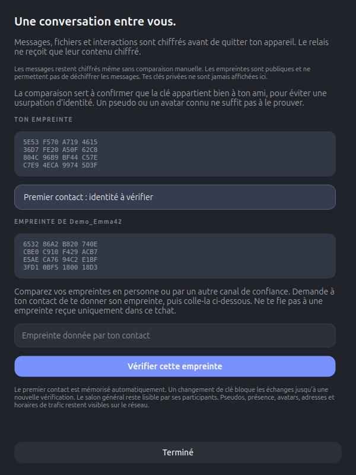
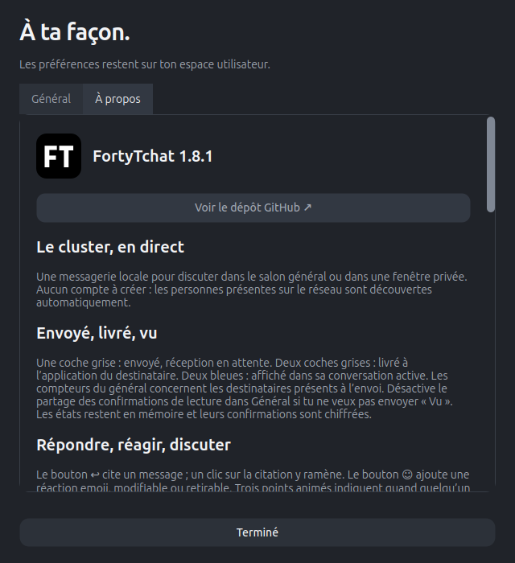

<p align="center">
  <a href="assets/logo.png"></a>
</p>

<h1 align="center">FortyTchat</h1>
<p align="center"><strong>Ton cluster. Tes amis. Une conversation, maintenant.</strong></p>
<p align="center">Version <strong>1.8.1</strong> · Ubuntu/Linux · Python 3.10+</p>

<p align="center">
  <a href="#installer-et-démarrer">Installer</a> ·
  <a href="#mettre-à-jour">Mettre à jour</a> ·
  <a href="#aperçu">Aperçu</a> ·
  <a href="#amis">Amis</a> ·
  <a href="#chiffrement-de-bout-en-bout">Chiffrement</a> ·
  <a href="#désinstaller">Désinstaller</a>
</p>

**FortyTchat** est une messagerie pour les étudiants de 42 en cluster : un salon **#général**, des conversations privées dans leurs propres fenêtres, des amis et des notifications animées. Aucun compte à créer, aucune adresse IP à saisir, aucun sudo.

Les messages sont **chiffrés de bout en bout** et restent en mémoire jusqu’à l’arrêt complet du processus. Ton profil et tes préférences sont conservés ; les fichiers que tu choisis d’enregistrer restent sur disque.

## Installer et démarrer

Il faut **Git** et **Python 3.10 ou plus récent**. Installation dans le dossier caché `~/.FortyTchat`, avec ta clé SSH GitHub déjà configurée :

```sh
git clone git@github.com:Chrisnox-209/FortyTchat.git "$HOME/.FortyTchat" && sh "$HOME/.FortyTchat/install.sh"
```

Sans clé SSH, le dépôt public s’installe aussi en HTTPS :

```sh
git clone https://github.com/Chrisnox-209/FortyTchat.git "$HOME/.FortyTchat" && sh "$HOME/.FortyTchat/install.sh"
```

L’installateur prépare un environnement Python personnel, copie l’application et crée son lanceur ainsi que son entrée de démarrage automatique. FortyTchat démarre **réduit dans la barre**, puis découvre les personnes présentes sur le réseau. Si le dossier existe déjà, suivre [Mettre à jour](#mettre-à-jour).

- **Icône FT noire** dans la barre : ouvrir le tchat par doubleclic, activation principale, clic milieu ou **Ouvrir FortyTchat** dans son menu.
- **Icône rouge et compteur** : des messages attendent d’être consultés.
- **Clic droit** : amis en ligne/hors ligne, envoi de popup, statut et paramètres.
- **Fermer la fenêtre** garde le programme actif. **Quitter complètement** ou `Ctrl+Q` arrête le processus et efface ses conversations.

Le placement près de Discord et la mise au premier plan dépendent du bureau. Sans barre compatible, la fenêtre reste accessible dans le dock ou avec le lanceur :

```sh
~/.local/bin/fortytchat
```

<details>
<summary>Autres modes d’installation</summary>

Depuis un dossier du projet déjà téléchargé :

```sh
sh ./install.sh
```

Avec un Python déjà équipé de PySide6 et PyNaCl, sans téléchargement :

```sh
sh ./install.sh --use-current-python
```

`--no-launch` installe sans lancer l’application ; `--bin-dir DOSSIER` choisit le dossier du lanceur. Le script ne modifie aucun paquet système. Avec Python 3.14, il utilise PySide6 **6.12 minimum**. L’absence de `venv` ou d’une bibliothèque native Qt est signalée ; aucun composant système n’est installé automatiquement.

</details>

## Mettre à jour

Ce bloc **ferme proprement la copie installée de FortyTchat**, attend sa fermeture (jusqu’à dix secondes), puis récupère et installe la mise à jour. Copier le bloc entier dans le terminal :

```sh
(
  echec() { printf '%s\n' "$1" >&2; exit 1; }

  cd "$HOME/.FortyTchat" || echec 'Dépôt introuvable : vérifie ~/.FortyTchat.'

  python3 -c 'from tools.uninstall_user import data_home, stop_installed; stop_installed(data_home() / "fortytchat" / "app")' \
    || echec 'Fermeture impossible : quitte FortyTchat depuis son icône puis réessaie.'

  git pull --ff-only \
    || echec 'Git a échoué : installation non lancée. Consulte le message ci-dessus.'

  sh ./install.sh \
    || echec 'Installation échouée : consulte le message ci-dessus avant de réessayer.'

  printf '%s\n' 'Mise à jour terminée.'
)
```

La fonction de fermeture utilisée vient de l’outil de désinstallation, mais **aucune désinstallation n’est exécutée**. Elle cible seulement cette copie de l’application appartenant à ton utilisateur et respecte `XDG_DATA_HOME`. Les conversations en mémoire sont effacées à l’arrêt complet.

**En cas d’échec, le bloc s’arrête avec un code d’erreur** et affiche l’étape concernée :

- **Fermeture impossible** : aucune récupération ni installation n’est lancée. Quitter complètement depuis l’icône, puis recommencer.
- **Échec Git** : l’installateur n’est pas lancé. Vérifier la connexion, l’accès GitHub ou les modifications locales indiquées par Git avant de réessayer. La copie déjà installée reste disponible avec `~/.local/bin/fortytchat`.
- **Échec d’installation** : corriger l’erreur affichée, puis relancer `sh "$HOME/.FortyTchat/install.sh"`. Le message de réussite n’est pas affiché en cas d’erreur.

Le profil, les amis, les modèles de notifications et les clés sont conservés. Une installation réussie relance l’application réduite et respecte un démarrage automatique désactivé. Aucun script `update.sh` n’est nécessaire.

## Aperçu

<p align="center">
  <a href="docs/friends-1.6.0.png"></a>
</p>
<p align="center"><em>Le général et les amis, dans le thème anthracite et bleu. Un thème clair est aussi disponible.</em></p>

Les captures sont réparties ci-dessous, avec chaque fonction. Elles utilisent des profils et textes de démonstration ; les fonctions inchangées gardent leurs captures antérieures. Cliquer sur une image l’ouvre en grand.

## Discuter

Le **#général** réunit les personnes présentes. Cliquer sur une personne ouvre une conversation privée dans une **nouvelle fenêtre indépendante**, sans rechercher son pseudo. Plusieurs conversations peuvent rester ouvertes.

| Raccourci | Action |
| --- | --- |
| `Entrée` | Envoyer |
| `Maj+Entrée` | Ajouter une ligne |
| `Ctrl+K` | Aller à la liste des personnes |
| `Ctrl+,` | Ouvrir les paramètres |

Les messages sont affichés en texte brut. Un nouvel arrivant ne reçoit aucun message antérieur. Les collisions de pseudo sont résolues automatiquement ; les destinataires sont identifiés par leur session, pas par leur nom ou leur IP.

### Envoyé, livré et vu

| Indication | Signification |
| --- | --- |
| **✓ Envoyé**, gris | Envoi lancé, confirmation de réception en attente |
| **✓✓ Livré**, gris | Réception confirmée par l’application du destinataire |
| **✓✓ Vu**, bleu | Message affiché dans la zone visible de sa conversation active |
| **! Non confirmé** | Confirmation absente ; le message a pu être reçu |
| **○ Local** | Aucun autre participant : message visible uniquement ici |

Une fenêtre fermée, minimisée, inactive ou un message hors de la zone visible n’envoie pas « Vu ». Dans le général, les compteurs concernent les destinataires présents lors de l’envoi ; les deux coches deviennent bleues quand tous ont confirmé la lecture. Le survol détaille les confirmations.

**Paramètres → Général → Partager les confirmations de lecture** permet de désactiver l’envoi des « Vu ». La livraison reste confirmée et les confirmations déjà partagées restent visibles. Les deux clients doivent prendre en charge la lecture (**1.6.0 minimum**) ; un ancien client chiffré continue à recevoir les messages. Les états sont chiffrés, conservés en mémoire et ne constituent pas une garantie de lecture attentive.

## Répondre et réagir

- **↩ Répondre** cite le message au-dessus du champ de saisie. Cliquer sur une citation revient au message d’origine ; **×** annule une citation en cours.
- **☺ Réagir** ouvre les réactions rapides ou **Tous les emojis…**. Choisir un autre emoji remplace ta réaction ; choisir à nouveau le même la retire.
- **Trois points animés** indiquent qu’une personne écrit. Son brouillon reste sur son appareil ; l’indicateur disparaît après l’envoi ou l’inactivité.

<p align="center">
  <a href="docs/social-1.6.0.png"></a>
</p>

Ces interactions restent en mémoire avec la conversation. Une citation disparue de la mémoire affiche **Message plus disponible** ; aucun historique n’est téléchargé pour la reconstituer.

## Amis

Ajouter une personne avec **☆** dans sa conversation ou **clic droit → Ajouter aux amis** dans la liste. Les amis restent visibles **en ligne et hors ligne**, et sont reconnus après changement de pseudo ou redémarrage avec le même profil. Jusqu’à **256 amis** peuvent être conservés.

### Depuis l’icône FT

**Clic droit sur l’icône → Amis en ligne → nom de l’ami → Envoyer une popup…** ouvre directement l’éditeur, sans ouvrir une conversation. **Discuter…** ouvre son tchat privé. Le clic droit sur un ami dans la liste du tchat propose les mêmes actions.

<p align="center">
  <a href="docs/tray-friends-1.8.0.png"></a>
</p>

Une popup exige un ami connecté, non masqué et compatible, avec une clé autorisée. L’action retrouve sa session actuelle ; aucun envoi hors ligne n’est mis en attente. Une clé modifiée reste bloquée jusqu’à [vérification de l’empreinte](#chiffrement-de-bout-en-bout).

### Quand un ami se connecte

Une bannière native **« Pseudo est en ligne »** avertit de sa connexion, sans son demandé. Plusieurs arrivées simultanées sont regroupées. [**Paramètres → Général → Notifier la connexion de mes amis**](docs/settings-1.8.0.png) désactive ces alertes ; **Ne pas déranger** les masque aussi, sans rattrapage ensuite.

La découverte des cinq premières secondes, les changements de pseudo/statut, une deuxième session et l’ajout d’un ami déjà connecté restent silencieux. Les coupures de moins de cinq secondes sont ignorées ; un même ami ne déclenche pas plus d’une alerte par minute. Les sessions masquées et les clés modifiées ne déclenchent pas d’alerte.

Les bannières utilisent `notify-send` lorsqu’il est disponible. Leur position et leur apparence sont gérées par Ubuntu/GNOME et son propre mode Ne pas déranger : [aide GNOME](https://help.gnome.org/gnome-help/shell-notifications.html.en), [service freedesktop](https://specifications.freedesktop.org/notification/latest-single/).

## Avatars et images personnelles

Cliquer sur son avatar en bas à gauche, ou ouvrir **Paramètres → Changer d’avatar**. Choisir parmi **24 personnages**, le mode automatique ou **Importer mon image…**.

<table>
<tr>
<td align="center" width="50%" valign="top"><a href="docs/avatars-photo-import.png"></a><p>Choisis un personnage ou ta photo.</p></td>
<td align="center" width="50%" valign="top"><a href="docs/avatar-crop-preview.png"></a><p>Déplace, zoome, puis valide le cadrage.</p></td>
</tr>
</table>

Formats PNG, JPEG et WebP, moins de **10 Mo**. L’import est asynchrone et annulable. Seule une miniature JPEG **128 × 128**, au plus **8 Kio**, est sauvegardée et partagée ; le nom du fichier et ses métadonnées ne sont pas transmis. Les avatars reçus restent en mémoire. La miniature est un profil public, visible sur le réseau.

**Retirer mon image** ou choisir un personnage enlève la photo personnelle.

## Emojis

Le sélecteur propose **3 781 emojis**, **neuf catégories** et une recherche français/anglais : « café », « coeur », « chat », « football »… Le catalogue est embarqué et fonctionne hors ligne. Un libellé remplace les glyphes absents de la police dans le sélecteur ; leur insertion reste Unicode.

<p align="center">
  <a href="docs/emojis-1.1.0.png"></a>
</p>

## Wizz et pauses

**Wizz** ouvre la conversation au dernier message et la fait vibrer pendant **2,8 secondes**, sans son. Un seul envoi toutes les **42 minutes**, tous destinataires confondus. Sous X11 la fenêtre bouge ; sous Wayland son contenu vibre, car le bureau contrôle le placement et la mise au premier plan.

**On fait une pause ?** affiche une carte bleue au centre de l’écran, valable **2 minutes**, même en Ne pas déranger. Les réponses **« yessss !! »** et **« Non je bosse !! »** reviennent à l’expéditeur en bleu ou en rouge. Fermer une pause classique signale une invitation non confirmée.

<table>
<tr>
<td align="center" width="50%" valign="top"><a href="docs/pause-invite-1.4.0.png"></a><p>Une pause entre potes.</p></td>
<td align="center" width="50%" valign="top"><a href="docs/notification-reply-yes-1.4.0.png"></a><p>Bleu pour oui, <a href="docs/notification-reply-no-1.4.0.png">rouge pour non</a>.</p></td>
</tr>
</table>

Pauses et notifications personnalisées partagent une limite de **trois demandes successives par destinataire**. La quatrième bloque ces demandes pendant **cinq minutes**, sans bloquer les messages ni prolonger le délai à chaque tentative. Après cinq minutes sans demande, une nouvelle série commence.

## Notifications personnalisées

Dans une conversation, cliquer sur **✦**, ou choisir **Envoyer une popup…** dans les amis :

1. Choisir un **titre** (80 caractères), un **texte** (400 caractères) et un des **11 emojis animés**.
2. Préparer jusqu’à **trois boutons** : libellé, type **Oui / Non / Autre**, texte et emoji de la réponse renvoyée.
3. Autoriser une **réponse libre**, ou choisir **Fermer uniquement** pour une information sans réponse attendue.
4. Vérifier l’**Aperçu**, puis **Envoyer**.

<table>
<tr>
<td align="center" width="50%" valign="top"><a href="docs/notification-editor-1.7.0.png"></a><p>Prépare ton message et ses réponses.</p></td>
<td align="center" width="50%" valign="top"><a href="docs/notification-choices-1.7.0.png"></a><p>Le destinataire choisit parmi tes propositions.</p></td>
</tr>
</table>

**Fermer reste disponible**. Sur les cartes avec choix explicites, bouton Fermer, croix, Échap et expiration ne renvoient ni oui ni non. Une réponse préparée renvoie exactement son contenu ; le retour est bleu pour Oui/Autre et rouge pour Non. Voir aussi [une carte Fermer uniquement](docs/notification-info-1.7.0.png) et [l’édition d’une réponse](docs/notification-response-editor-1.7.0.png).

<p align="center">
  
  
  
</p>

Animations intégrées : **👍 😭 🤣 😘 👎 😛 💩 ❌ ✅ 🤯 💪**. Aucun téléchargement d’image n’est demandé au destinataire. **Enregistrer ce modèle** conserve volontairement son contenu et ses choix ; jusqu’à **12 modèles**, notifications et réponses confondues, sont disponibles depuis **Paramètres → Mes notifications animées**, même hors connexion.

Une demande expire après **deux minutes** et suit la limite des pauses. **Ne pas déranger** refuse les nouvelles notifications personnalisées ; les pauses classiques et les réponses aux demandes déjà reçues restent actives. Les choix explicites nécessitent **1.7.0 chez les deux participants** ; un ancien client chiffré garde les cartes classiques. L’éditeur signale une incompatibilité sans transformer une information en question Oui/Non. Toutes les cartes et réponses sont chiffrées.

## Envoyer un fichier

Le bouton **＋** joint un fichier au général ou à une conversation privée. Le destinataire choisit **Enregistrer…**, son emplacement, ou refuse. Progression et annulation apparaissent dans le tchat.

Limite : **20 Mio**, offre valable **10 minutes**, clients et relais **1.5.0 minimum**. Nom, empreinte et contenu sont chiffrés. Aucun téléchargement ni ouverture automatique ; aucun fichier existant n’est écrasé. Les fichiers enregistrés restent sur disque après fermeture de l’application.

## Chiffrement de bout en bout

Le chiffrement est **toujours actif**, en direct et via le relais : messages, fichiers, citations, réactions, saisie, Wizz et notifications. Les clés de session sont renouvelées à chaque démarrage. Le relais transporte des enveloppes opaques et ne possède pas les clés pour les déchiffrer. Le général remet une copie chiffrée par destinataire ; ses participants peuvent naturellement lire ses messages.

### Vérifier un contact avec le cadenas

Une **empreinte est publique** : c’est un résumé de la clé publique d’identité. Elle reste visible et peut être sélectionnée pour la comparer. Les clés privées ne sont jamais affichées ici. **Les messages restent chiffrés même sans comparer les empreintes** ; les clés sont gérées automatiquement.

La comparaison sert à confirmer que la clé appartient bien à ton ami, pour éviter une usurpation d’identité. Un pseudo ou un avatar connu ne suffit pas à le prouver.

1. Ouvrir le **cadenas** de la conversation pour lire les empreintes.
2. Comparer les empreintes **en personne ou par un autre canal de confiance**. Une empreinte reçue seulement dans ce tchat ne vérifie pas le premier contact.
3. Coller celle donnée par le contact et cliquer sur **Vérifier cette empreinte**.

<p align="center">
  <a href="docs/security-1.8.1.png"></a>
</p>

Le premier contact est mémorisé automatiquement (**TOFU**), puis l’empreinte permet de confirmer son identité. Un changement de clé **bloque les échanges** jusqu’à comparaison et autorisation explicite.

La clé privée du profil reste dans `identity.json` et les clés publiques des contacts dans `trusted_contacts.json`, avec permissions **600**. Garder ensemble `config.json`, `identity.json` et `trusted_contacts.json` lors d’une sauvegarde, en protégeant la clé privée. Un fichier de sécurité corrompu, manquant dans un profil initialisé ou non privé bloque le démarrage au lieu de recréer silencieusement les clés.

L’intégration utilise **PyNaCl/libsodium**, Box Curve25519/XSalsa20/Poly1305 et les signatures Ed25519. Elle n’a pas reçu d’audit indépendant et n’implémente pas le Double Ratchet. Elle ne cache pas les pseudos, présence, avatars ou métadonnées de trafic et ne protège pas un appareil compromis. Les clients et relais antérieurs à **1.5.0** sont refusés, sans repli en clair. [Protocole et limites](docs/NETWORK.md), [Box](https://pynacl.readthedocs.io/en/latest/public/), [signatures](https://pynacl.readthedocs.io/en/latest/signing/).

## Préférences et données conservées

Dans **Paramètres**, choisir le pseudo, le thème, l’avatar, le démarrage automatique, les Wizz, les alertes d’amis et le partage des confirmations de lecture. **À propos** contient la version, les fonctions et le lien du dépôt.

**Ne pas déranger** laisse recevoir les messages et fichiers sans notification, refuse les Wizz et les nouvelles cartes personnalisées. Les **demandes de pause et les réponses en cours restent actives**. Le menu `···` d’une conversation masque une session jusqu’à l’arrêt de l’application.

<details>
<summary>Voir l’onglet À propos</summary>

<p align="center">
  <a href="docs/about-1.8.1.png"></a>
</p>

Les onglets Général et À propos sont défilables pour rester lisibles sur les petits écrans.

</details>

| Emplacement par défaut | Usage |
| --- | --- |
| `~/.FortyTchat/` | Dépôt source caché pour les mises à jour |
| `~/.local/share/fortytchat/app/` | Copie installée ; son `network.json` contient le déploiement réseau |
| `~/.local/share/fortytchat/venv/` | Python et dépendances dédiés |
| `~/.config/fortytchat/` | Profil, amis, miniature, préférences, clés et modèles enregistrés volontairement |
| `~/.local/bin/fortytchat` | Lanceur |
| `~/.local/share/applications/fr.fortytchat.FortyTchat.desktop` | Entrée du menu des applications |
| `~/.config/autostart/fr.fortytchat.FortyTchat.desktop` | Démarrage personnel réduit |
| `/tmp/fortytchat-UID/` | Verrou et socket d’activation, aucun message |

Les chemins XDG absolus personnalisés sont respectés. Une seule instance fonctionne par utilisateur et session graphique. Une entrée de démarrage désactivée ou supprimée n’est pas réactivée à la réinstallation. Une politique de session peut empêcher XDG Autostart ; le programme ne la contourne pas. Après déplacement des sources, relancer une entrée toujours activée actualise ses chemins. [Spécification XDG Autostart](https://specifications.freedesktop.org/autostart/latest/).

Aucun fichier de conversation ni historique serveur. La mémoire est bornée à **200 messages par conversation**, **64 conversations** et **4 000 messages** en tout ; chaque fenêtre affiche au plus les 180 derniers. Les messages déjà reçus chez d’autres participants restent dans leur mémoire jusqu’à leur propre arrêt. Le système peut utiliser du swap et un destinataire peut copier ou capturer ses messages ; aucun contrôle de ces copies n’est revendiqué.

## Désinstaller

```sh
sh "$HOME/.FortyTchat/uninstall.sh"
```

Le script retire cette installation, son lanceur et ses entrées XDG, en conservant le profil et le dépôt téléchargé. Quitter complètement FortyTchat avant de lancer la désinstallation.

Pour supprimer **également le profil, les clés et les profils de développement** :

```sh
sh "$HOME/.FortyTchat/uninstall.sh" --purge
```

Une nouvelle installation créera alors une autre identité que tes contacts devront vérifier. Avec un dossier de lanceur personnalisé, préciser le même `--bin-dir DOSSIER`.

## Dépannage

| Problème | À vérifier |
| --- | --- |
| Ancien design ou texte tronqué | Quitter complètement, [mettre à jour](#mettre-à-jour), puis vérifier **1.8.1** dans le titre des paramètres. Les onglets défilent avec la molette. |
| Icône absente ou mal placée | La session doit prendre en charge GNOME/StatusNotifier/AppIndicator. Utiliser le dock ou le lanceur sinon ; la place dans la barre dépend du bureau. |
| Un clic ouvre le menu, le doubleclic ne marche pas | L’option **Compatibilité doubleclic de l’icône (GNOME)** tente de reconnaître l’ouverture/fermeture rapide du menu. Elle dépend des événements transmis par la barre. Utiliser **Ouvrir FortyTchat** si nécessaire. |
| Une fermeture rapide du menu ouvre le tchat | Désactiver cette compatibilité dans Général. Échap peut être indistinguable d’un second clic sur certaines barres. Aucune extension du bureau n’est modifiée. |
| Aucune personne en ligne à la maison | Un autre client doit être présent sur le réseau ; utiliser les [profils de développement](#développer-et-tester-à-domicile) pour tester sur un PC. |
| Personne absente sur deux PC | Vérifier les autorisations de découverte UDP et TCP inter-postes. VLAN, Wi-Fi invité ou isolation réseau peuvent bloquer les échanges. |
| Clé d’un contact modifiée | Ouvrir son cadenas et comparer sa nouvelle empreinte par un canal de confiance. Ne pas effacer les clés pour contourner le blocage. |
| Aucune bannière de connexion | Vérifier l’option d’alerte, DND dans FortyTchat et Ubuntu, et `notify-send`. Le démarrage initial et les reconnexions rapprochées restent silencieux. |
| Popup grisée dans les amis | L’ami doit être connecté, autorisé, non masqué et compatible ; le relais doit accepter les cartes sans route directe. |
| Application absente au début de session | Vérifier l’option de démarrage et la politique XDG de la session. |

Les problèmes initiaux de texte tronqué sont documentés par les [captures Ubuntu fournies pendant les essais](docs/screenshots/). Les corrections de mise à l’échelle sont couvertes par les tests locaux ; le comportement réel de GNOME/Wayland sur les postes de l’école reste à vérifier.

## Réseau et relais

La découverte est automatique. Aucun réglage réseau n’est accessible dans l’interface ; les paramètres de déploiement sont dans **`network.json`**, créé depuis [network.example.json](network.example.json) puis conservé aux mises à jour.

| Service | Transport | Port par défaut |
| --- | --- | --- |
| Découverte locale | UDP multicast | **39741** |
| Messages et fichiers directs | TCP | **39742** |
| Relais facultatif | TCP + TLS | **39743** |

Une version précédente a été testée en cluster par son créateur. Cela ne garantit pas la communication entre tous les VLAN ou campus. Si le LAN est filtré, un relais exige une machine autorisée, un DNS et un certificat TLS approuvé. Un certificat invalide ne provoque aucun repli silencieux en clair.

Commandes de diagnostic sans sudo, sans contenu de conversation :

```sh
python3 main.py --diagnose
python3 tools/network_probe.py
```

Ces commandes vérifient les binds locaux ; elles ne prouvent pas une communication entre postes. Le port déjà utilisé par FortyTchat peut apparaître occupé. Voir [l’architecture réseau](docs/NETWORK.md) et les [essais à réaliser à l’école](docs/SCHOOL_CHECKLIST.md). Pour l’intégration de barre : [Qt QSystemTrayIcon](https://doc.qt.io/qt-6.12/qsystemtrayicon.html), [GNOME/AppIndicator](https://github.com/ubuntu/gnome-shell-extension-appindicator).

## Développer et tester à domicile

Depuis les sources, préparer un environnement utilisateur :

```sh
python3 -m venv .venv
. .venv/bin/activate
python3 -m pip install -r requirements.txt
python3 main.py
```

Deux profils isolés sur un seul PC, sans modifier le démarrage automatique :

```sh
python3 main.py --dev alice
python3 main.py --dev bob
```

Ils utilisent `~/.config/fortytchat-dev/PROFIL/`, la même découverte UDP et des ports TCP dynamiques. Chaque processus repart sans messages. `--background` lance discrètement une instance normale.

Pour un relais local de développement, sans TLS et limité à la boucle locale :

```sh
python3 -m src.networking.relay --insecure-local --port 39743
python3 main.py --dev alice --insecure-local-relay 39743
python3 main.py --dev bob --insecure-local-relay 39743
```

Tests automatisés dans l’environnement équipé des dépendances :

```sh
python3 -m pip install -r requirements-dev.txt
QT_QPA_PLATFORM=offscreen python3 -m pytest -q
python3 tools/stress_test.py --clients 200
```

Les **168 tests** couvrent le réseau réel local, le chiffrement, les fichiers, les amis, les cartes, les confirmations de lecture, l’installation et l’interface aux échelles **100 %, 150 % et 200 %**. Les profils sont temporaires et les essais hors écran n’envoient pas de notifications au bureau personnel. Les sockets doivent être autorisées pour les tests d’intégration. Résultats et limites : [docs/VALIDATION.md](docs/VALIDATION.md).

## Crédits des ressources

Les **11 GIF Animated Noto Emoji de Google**, fournis via EmojiTerra, sont distribués sous [CC BY 4.0](https://creativecommons.org/licenses/by/4.0/), selon la [documentation officielle Noto](https://googlefonts.github.io/noto-emoji-files/?view=docs). Ils sont intégrés sans modification ; seul l’affichage est redimensionné. [Sources et empreintes](assets/animated/ATTRIBUTION.md), [licence](assets/animated/LICENSE.txt).

Le catalogue utilise [Unicode Emoji 16.0](https://www.unicode.org/Public/emoji/16.0/emoji-test.txt) et les annotations françaises [CLDR 46.1](https://github.com/unicode-org/cldr-json/tree/46.1.0). La [licence Unicode](assets/emoji/UNICODE_LICENSE.txt) est incluse ; `tools/build_emoji_catalog.py` permet de reconstruire les données embarquées.
